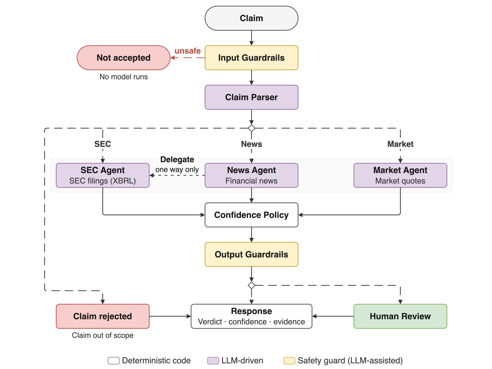

I build agentic AI systems for regulated domains and evaluate them the way a model-risk team would: against criteria fixed before the first run, with every decisive output traced to its source. My background is model development and evaluation, first in academic research on energy data and then in banking.

## What I'm working on

**[FinVet](https://github.com/danielberhane/finvet)** is an agentic system that checks financial claims against SEC filings, market data and news. Built with LangGraph, it routes each claim to a specialized agent. The model interprets the claim and gathers the evidence; deterministic code compares the figure and decides the verdict; a claim without a source-traced figure is declined rather than guessed.

I evaluated it on 325 held-out claims about 72 US-listed companies, with two models, four runs each, and acceptance criteria defined before testing began. Every published figure is recomputed from the run artifacts on each CI run.

## Other projects

- **[forest-carbon-mcp](https://github.com/danielberhane/forest-carbon-mcp)**: an MCP server giving AI models structured access to 24 years of Global Forest Watch deforestation and carbon data, built with Erasmus.AI for ClimateGPT.
- **[neighborcast](https://github.com/danielberhane/neighborcast)**: 12-month home price forecasts for 21,605 US neighborhoods, with leakage-tested rolling-origin backtests.
- **[wattnorm](https://github.com/danielberhane/wattnorm)**: real-time energy anomaly detection for buildings, from MQTT through TimescaleDB to Grafana.
- **[cuda-kmeans](https://github.com/danielberhane/cuda-kmeans)**: k-means in CUDA C, benchmarked against MPI, OpenMP and a sequential baseline.

## Earlier work

**[FinVet v1](https://github.com/danielberhane/finvet-v1)**, IEEE BigData 2025, with Duoduo Liao · [paper](https://ieeexplore.ieee.org/document/11400848)

## Contact

[LinkedIn](https://www.linkedin.com/in/dberhane)
